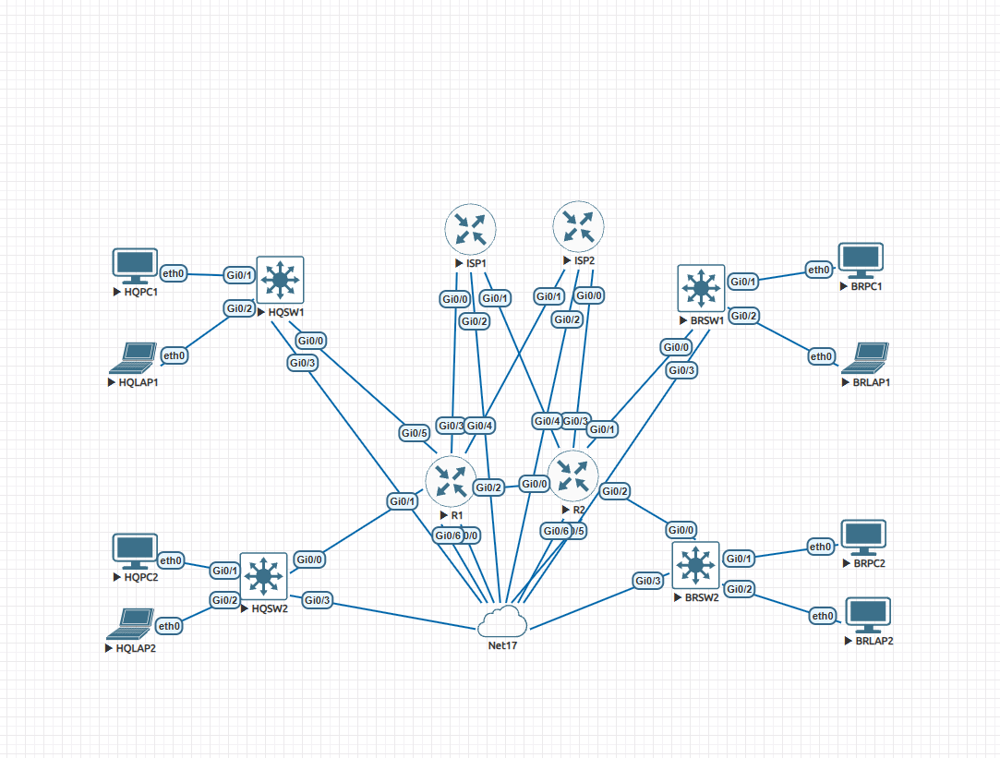

# Two-Site Network Automation Lab

A two-site Cisco network I built in EVE-NG and configure with a single Python script using Netmiko. The script handles VLANs, DHCP, OSPF, eBGP to two ISPs, NAT and ACLs across four Layer 3 switches and two edge routers.

I built this to practice network automation for the Cisco DevNet Associate exam. I wanted something bigger than a one-switch demo, with real redundancy that I could break and watch recover.



## What the script configures

I built it in five phases and committed each one separately, so the history shows how it grew.

| Phase | Devices | What gets configured |
|---|---|---|
| 1 | Switches | VLAN 10 (Staff) and VLAN 20 (Guest), access ports with PortFast, SVIs as gateways, DHCP pools |
| 2 | Switches and routers | Loopbacks, routed uplinks, OSPF area 0 everywhere inside |
| 3 | Routers | eBGP to both ISPs, iBGP between R1 and R2, default route passed into OSPF |
| 4 | Routers | PAT with one route-map per ISP, so NAT follows whichever ISP the traffic leaves through |
| 5 | Switches | Extended ACLs so Staff and Guest can't reach each other, on the same switch or across sites |

The ISP routers are configured by hand, not by the script. In real life the ISP's routers aren't yours to touch, so I kept them out on purpose. Their configs are in `manual/isp_configs.txt`.

## Design

**Sites:** HQ sits behind R1 (HQSW1, HQSW2). The branch sits behind R2 (BRSW1, BRSW2). Each switch has one PC (Staff) and one laptop (Guest).

**Addressing:** Each switch gets its own pair of /24s. The third octet is the switch number followed by 1 for Staff or 2 for Guest, so HQSW1 Staff is 192.168.11.0/24 and BRSW2 Guest is 192.168.42.0/24. Gateways are always .1, and DHCP starts handing out at .10.

| Switch | Staff (VLAN 10) | Guest (VLAN 20) | Loopback | Uplink |
|---|---|---|---|---|
| HQSW1 | 192.168.11.0/24 | 192.168.12.0/24 | 192.168.255.11 | 192.168.100.0/30 to R1 |
| HQSW2 | 192.168.21.0/24 | 192.168.22.0/24 | 192.168.255.12 | 192.168.100.4/30 to R1 |
| BRSW1 | 192.168.31.0/24 | 192.168.32.0/24 | 192.168.255.21 | 192.168.100.8/30 to R2 |
| BRSW2 | 192.168.41.0/24 | 192.168.42.0/24 | 192.168.255.22 | 192.168.100.12/30 to R2 |

R1 and R2 are linked on 192.168.100.16/30, with loopbacks 192.168.255.1 and .2.

**ISPs:**

| | AS | Link to R1 | Link to R2 | Fake internet host |
|---|---|---|---|---|
| My network (R1, R2) | 65000 | | | |
| ISP1 | 65101 | 203.0.113.0/30 | 203.0.113.4/30 | 8.8.8.8 |
| ISP2 | 65102 | 198.51.100.0/30 | 198.51.100.4/30 | 9.9.9.9 |

Both routers connect to both ISPs, so losing any single link or ISP doesn't take anyone offline.

**Staff/Guest policy:** VLAN 10 and VLAN 20 can't talk to each other at all, at either site, in either direction. Staff can still reach Staff at the other site, Guest can reach Guest, and both can reach the internet. Each switch gets two ACLs (STAFF-IN on Vlan10, GUEST-IN on Vlan20), and the deny lines are generated by looping over every switch in the data, so adding a fifth switch would update everyone's ACLs automatically.

**Management:** Every device has a spare port on an out-of-band management network (192.168.203.0/24, the EVE-NG Cloud0 network). The script connects over that, so I can't lock myself out by breaking routing.

## How the script is laid out

`devices_config.py` has four parts:

1. **Data:** a `switches` list and a `routers` list. Everything that differs between devices lives here.
2. **Builders:** `build_switch_config()` and `build_router_conf()` turn one device's data into a list of IOS commands.
3. **Pusher:** `push_config()` logs in with Netmiko, sends the commands and saves the config.
4. **Workers:** loops that build, save and push each device. If one device fails, it's reported and the script moves on to the next.

To change the network I edit the data, not the code.

## Running it

```
pip install -r requirements.txt
```

Before the script can log in, each device needs a management IP, a local user and SSH turned on. That part is done once by hand (see `manual/ssh_bootstrap.txt`).

```
python devices_config.py                       # dry run: writes the configs to .txt files, touches nothing
python devices_config.py --push                # pushes to every device
python devices_config.py --push --only HQSW2   # pushes to one device
```

Dry run is the default on purpose. I always check the generated files before pushing anything. The password is asked for at run time with `getpass`, so it's never stored in the code.

If any device fails, the summary at the end lists it, and `--only` lets me re-push just that one.

**Built with:** Python 3.14, Netmiko, paramiko 4.x, EVE-NG Community, Cisco IOSv 15.9 (routers) and IOSvL2 (switches).

## Results

**BGP:** R1 peering with both ISPs and with R2:

```
Neighbor        V           AS MsgRcvd MsgSent   TblVer  InQ OutQ Up/Down  State/PfxRcd
192.168.255.2   4        65000      35      36        6    0    0 00:25:42        3
198.51.100.1    4        65102      36      37        6    0    0 00:28:14        2
203.0.113.1     4        65101       8      10        6    0    0 00:00:10        2
```

**OSPF:** R1 neighbors:

```
R1#show ip ospf neighbor

Neighbor ID     Pri   State           Dead Time   Address         Interface
192.168.255.2     1   FULL/DR         00:00:39    192.168.100.18  GigabitEthernet0/2
192.168.255.12    1   FULL/DR         00:00:34    192.168.100.6   GigabitEthernet0/1
192.168.255.11    1   FULL/DR         00:00:38    192.168.100.2   GigabitEthernet0/5
```

**NAT and ISP failover:** With R1's link to ISP2 shut down, HQPC1's pings to 8.8.8.8 kept working and moved over to ISP1's address on their own:

```
R1#show ip nat translations
Pro Inside global      Inside local       Outside local      Outside global
icmp 203.0.113.2:21082 192.168.11.10:21082 8.8.8.8:21082     8.8.8.8:21082
icmp 203.0.113.2:21338 192.168.11.10:21338 8.8.8.8:21338     8.8.8.8:21338
```

**ACLs:** HQLAP2 (Guest) trying to reach HQPC1 (Staff) on the other HQ switch, blocked:

```
Extended IP access list GUEST-IN
    10 deny ip 192.168.22.0 0.0.0.255 192.168.11.0 0.0.0.255 (5 matches)
    20 deny ip 192.168.22.0 0.0.0.255 192.168.21.0 0.0.0.255
    30 deny ip 192.168.22.0 0.0.0.255 192.168.31.0 0.0.0.255
    40 deny ip 192.168.22.0 0.0.0.255 192.168.41.0 0.0.0.255
    50 permit ip any any (11 matches)
```

## Things that went wrong (and what I learned)

**SSH wouldn't connect.** The IOSvL2 and IOSv images only support old SHA-1 key exchange, MACs and ciphers, which modern Windows SSH turns off. I enabled them in my SSH config file for the lab subnet only (`192.168.203.*`), not globally.

**Netmiko failed with "no acceptable kex algorithm".** Paramiko 5.0 removed SHA-1 key exchange completely, so there's no setting to turn it back on. I pinned `paramiko<5`. On a real network the right fix is upgrading IOS, not downgrading the library.

**R1 wouldn't boot.** The console stayed blank. It turned out the vIOS image file on the EVE-NG server had been named wrong during upload. EVE-NG expects exactly `virtioa.qcow2`. Renaming it, running `fixpermissions` and wiping the nodes fixed every router at once.

**A bug with no error message.** In the NAT loop I wrote `for link in rt["isp_links"]` but used `isp[...]` inside it. Python didn't complain, because `isp` still held the last value from the BGP loop above, so both NAT rules would have come out for ISP2. I caught it by reading the generated config. Now I always check the output, not just that the script ran.

**Missing dots in the ACL.** `"192.168" + site` gave `192.1681.0`, which the switch rejects. The dry run caught it before anything was pushed, which is exactly why dry run is the default.

**Config order matters.** I once put `no shutdown` after a DHCP pool instead of under `interface Vlan20`. IOS applies a sub-command to whatever section was opened last, so the line order in the generated config has to match how you'd type it by hand.

## What's next

- Push the ISP configs from a separate script too
- Add a verification script that runs the show commands above and checks the results automatically
- Try RESTCONF on an IOS XE router instead of SSH and CLI
- Give each switch a second uplink to the other router, so a single router failure doesn't cut off a whole site